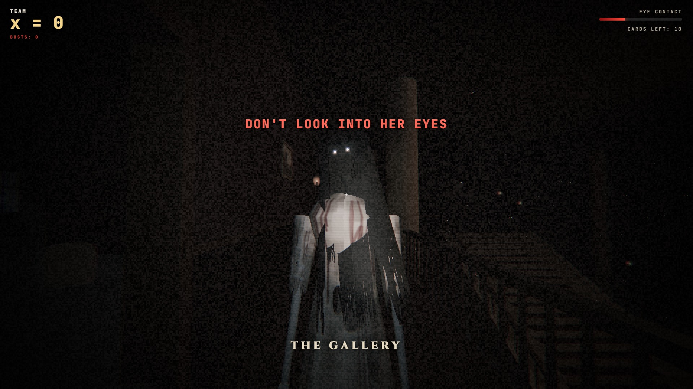
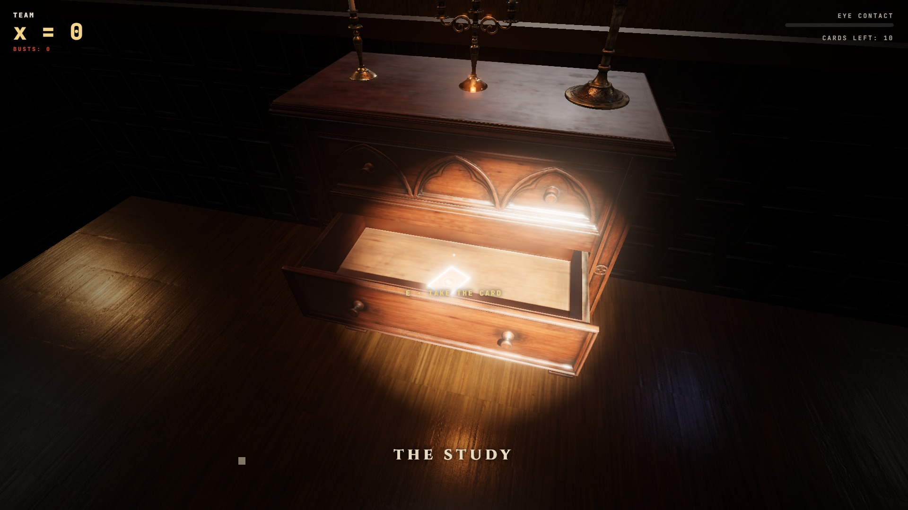
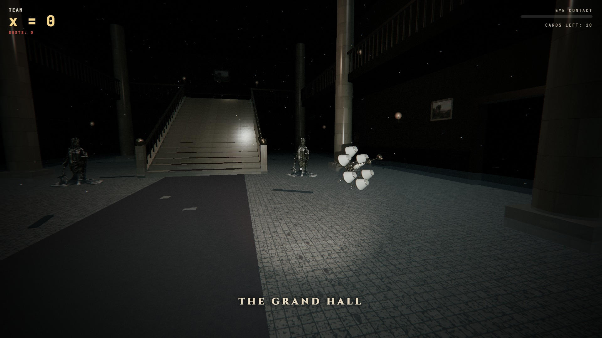
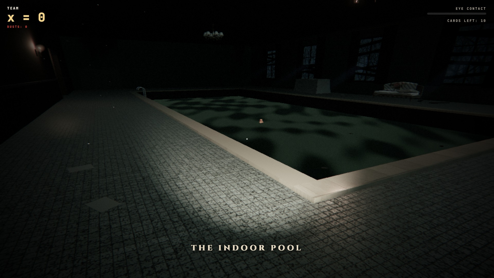

<div align="center">

# 🕯️ DEPTH FIRST FEAR

### A haunted first-person card game for the **PROCOM DSA Competition**

*Search an abandoned mansion. Read the code. Don't look into her eyes.*



</div>

---

## 👻 What is it?

**Depth First Fear** turns a Data Structures quiz into a horror game set in a haunted mansion.

Teams walk through a dark, abandoned two-floor mansion and its haunted grounds, a forest, a cemetery and a crypt, with only a flashlight. Drawers, cupboards, chests and coffins hide cards with a short piece of code on them. Read the code, work out what it does to your team's value `x`, and decide in time (1, 2 or 4 minutes, depending on the card): take it or drop it. Some cards raise `x`, some lower it.

The goal: have the **highest `x`** when the **60-minute** timer runs out.

But you are not alone in the house. She appears without warning. **Don't look into her eyes.**

<table>
  <tr>
    <td></td>
    <td></td>
    <td></td>
  </tr>
  <tr align="center">
    <td><sub>Cards hide in drawers</sub></td>
    <td><sub>The grand hall</sub></td>
    <td><sub>The abandoned pool</sub></td>
  </tr>
</table>

---

## 🚀 Quick start

You need **[Node.js](https://nodejs.org)** 18 or newer. No `npm install` is needed.

```bash
git clone https://github.com/tahaanwar31/DSA-Competition-.git
cd DSA-Competition-
```

**1. Add the secret settings.** Create a file called **`.env`** in the folder (ask Taha for the values):

```
SUPABASE_URL=https://<project>.supabase.co
SUPABASE_SECRET_KEY=sb_secret_...
PORT=8780
```

> [!CAUTION]
> `.env` holds the database's secret key. It is in `.gitignore`. **Never commit it, never paste it in chats.**

**2. Start the server**

```bash
node server.js
```

| Page | Who | What |
| --- | --- | --- |
| **http://localhost:8780** | teams | login (team name + password) |
| **/lobby** | teams | Round 01 and Round 02. A round opens by itself at its start time |
| **/round1** | teams | the mansion (only while Round 1 is open) |
| **/admin** | organisers | teams, cards, round times, lock / unlock, leaderboards |

**3. Make your admin login** (once):

```bash
node scripts/add-admin.js taha
```

> [!NOTE]
> An internet connection is needed: the database is on Supabase, and the 3D engine and fonts load from a CDN.

---

## 🛡️ Running the competition

1. **/admin → Teams:** add every team with a password (or paste many at once: `name, password, members` per line).
2. **/admin → Rounds:** set Round 1's **start** and **end** time and click **Unlock**. Teams wait in the lobby with a countdown; the round opens for everyone at the same moment, using the server's clock (a PC's own clock doesn't matter).
3. **Power cut or problem?** Click **Lock now**. Every team is sent back to the lobby at once and their progress is saved. When you unlock, choose:
   - **Continue**: same x, same used cards.
   - **Start fresh**: everyone back to x = 0 with every card.
   - One PC crashed? **Reset team** for just that team.
4. **One device per team:** if a team logs in on another PC, the first PC is logged out.
5. **Leaderboards:** Round 1, Round 2 and Final (Round 1 + Round 2). Click **Big screen** for the projector.

Round 2 shows **UNDER CONSTRUCTION** in the lobby for now.

---

## 🎮 Controls

| Key | Action |
| :---: | --- |
| <kbd>W</kbd> <kbd>A</kbd> <kbd>S</kbd> <kbd>D</kbd> | Move |
| <kbd>Mouse</kbd> | Look around |
| <kbd>Shift</kbd> | Run |
| <kbd>Space</kbd> | Jump (over fences, graves and low furniture) |
| <kbd>E</kbd> | Open / close a drawer, cupboard, chest or coffin |
| <kbd>C</kbd> | Grab the card inside |
| <kbd>E</kbd> / <kbd>Q</kbd> | **Take** / **drop** the card (1 / 2 / 4 minutes) |
| <kbd>F</kbd> | Flashlight on / off |
| <kbd>Esc</kbd> | Pause |

---

## 📜 Rules

1. Every team starts at **`x = 0`** and has **60 minutes**.
2. Open drawers, cupboards, chests and coffins to find cards. Each card shows code that changes `x`.
3. **Take** the card and `x` changes by its code. **Drop** it and `x` stays the same. Time to decide: **1 min** (easy), **2 min** (medium), **4 min** (hard).
4. Either way, the card **burns** and is gone. **Each card is in the mansion only once.**
5. Cards can **raise or lower** `x` (+, −, ×2, ×0 …), so read the code before you take it.
6. **Highest `x` when time runs out wins.** There is no upper limit.

### 🟢🟡🔴 Card levels

| Level | What it does to `x` | Time to decide | Where it hides |
| --- | --- | :---: | --- |
| 🟢 **Easy** | small, ±1 to ±14 | **1 min** | downstairs |
| 🟡 **Medium** | ±2 to ±26 | **2 min** | downstairs |
| 🔴 **Hard** | big or tricky: up to ±72, ×2, ×0 | **4 min** | the scariest places (upstairs and outside) |

Every card is sized so a team that knows the topic can finish it with **at least 5% of its time left** (estimated as 10 s to start, 3 s per line read and 1 s per step traced).

#### Topics at each level

Easy cards are a few plain steps read top to bottom (no loops to count). Medium and hard get harder:

| Topic | 🟢 Easy | 🟡 Medium | 🔴 Hard |
| --- | --- | --- | --- |
| **Stack** | push / pop, read the top or the size | reverse a word, postfix, min stack, two stacks | postfix with all four operators, queue from 2 stacks |
| **Queue** | push / pop, read the front or the size | rotate, interleave, ring buffer, hot potato | sliding window maximum, round robin |
| **Singly linked list** | follow `next` from nodes linked by hand | reverse, delete, middle node, insert | reverse then read, where the loop starts |
| **Doubly linked list** | follow `next` / `prev` | walk back from the tail, unlink a node | delete every even / odd node |
| **Circular linked list** | hops round a 2 or 3 node ring | laps, add at the tail | Josephus, split the ring |
| **BST** | read a key from a small tree built by hand | in / pre / post-order and height on 5 keys | common ancestor, range sum |
| **Recursion** | sum, factorial, digits (3 or 4 calls) | fast power, count the calls | two recursive calls |
| **BFS** | – | visit order, distance, level on 4 rooms | shortest path in a 3 × 3 maze |
| **DFS** | – | visit order, how many you can reach on 4 rooms | cycle detection |

Every team gets **the same cards**. Only the hiding places change from laptop to laptop, so no team gets an easier deck and teams can't tell each other where a card is.

### 👁️ The ghost

- She appears suddenly: right in front of you, far away down a corridor, or upside down on the ceiling.
- **Look into her eyes for a full second** and you are **busted: `x − 3`**.
- If a card's time runs out, it counts as a **drop**: no penalty, x stays the same, and the card burns.

### 🏆 Ties

In Round 1, if two teams have the same `x`, the team that **reached that `x` first** is ranked higher. "Reached" is the last moment the team's `x` changed (taking a card that changed it, or being caught by her), taken from the database clock to the microsecond. The leaderboards are worked out by the server (`boardsNow()` in `server.js`); the admin boards show this "Reached at" time to the millisecond.

---

## 🃏 The cards

The deck is **177 cards: 54 easy, 82 medium, 41 hard**, across every topic. Cards live in the **Supabase database**, not in the game files, so teams can't read them in the browser. The server only sends a card's code when a team opens it, and the **server** works out the new `x`.

Manage them in **/admin → Cards** (add, edit, remove, test an effect).

| Field | Meaning |
| --- | --- |
| Level | easy, medium or hard |
| Topic | small label on top of the card |
| Title | card title |
| Code | the snippet players read, in **C++, Java and Python** (same logic; players switch with keys 1 · 2 · 3). Stored as one JSON text `{"cpp", "java", "py"}` |
| Effect | what **taking** the card does to `x`, e.g. `x + 7`, `x * 2`, `0`. Only `x`, numbers and `+ - * / % ( )`. Integer maths like C++ (7 / 2 = 3) |

The organisers keep the full deck in `db/cards-data.js` and `db/cards-more.js`, which are **not** on GitHub (they hold the answers). `db/cards-more.js` makes its cards from small patterns and works out each answer itself. `db/card-names.js` then gives every card clear variable names (`pile`, `line`, `cur`, `room`, `visited` …), the same in all three languages, and uses only basic syntax (Python uses a plain list as the queue).

- `node scripts/check-cards.js` runs every card in all three languages (g++, javac/java, python) for many values of `x` and checks that each one matches its effect. It also checks the style: one statement per line, 4-space indents, no `vector`, no lambdas or `?:`, short lines. Java can come from `JAVA_HOME` or the runtime inside a JetBrains IDE.
- `node scripts/seed-cards.js` loads the deck into an empty database. `--update` rewrites the existing cards in place (same ids) and refuses once teams have opened cards.

Cards are dealt again on every load: the 177 cards fill about 95% of the 186 hiding spots; hard cards go upstairs or outside, easy and medium cards fill downstairs first and the last few spill upstairs. The card is black with old blood on it, the code uses the VS Code "Dark+" colours and is always **one column** that grows or shrinks to fit the screen. The timer is the card's border: a line of blood that drains away round the edge, with big red seconds in the corner.

---

## 🤝 Contributing

Co-heads: **don't push to `main`.** Make a branch, push it, and open a Pull Request. It gets merged after review.
The step-by-step guide is in **[CONTRIBUTING.md](CONTRIBUTING.md)**.

---

## 🗂️ Project structure

```
├── index.html          the whole game (Three.js, WebAudio, shaders)
├── server.js           web server + game rules API (Node.js, no packages)
├── web/                login, lobby and admin pages
├── db/
│   ├── schema.sql      tables and the 3 leaderboards (run in Supabase SQL Editor)
│   └── functions.sql   take / drop / bust / timers, all checked on the server
├── scripts/            add-admin, seed-cards, check-cards
├── assets/
│   ├── models/         3D furniture, statues, trees, gates (glTF)
│   ├── tex/            wall, floor and stone textures
│   └── ui/             menu backgrounds
└── docs/               screenshots and the proposal
```

---

## ✨ Features

- 🏚️ A full two-floor mansion: grand hall, library, study, kitchen, dining room, nursery, master bedroom, gallery and an abandoned indoor pool
- 🌲 Haunted grounds: courtyard, dead forest, cemetery and crypt, with rain, fog and lightning
- 🔐 Team login, lobby with timed rounds, admin panel, 3 live leaderboards (Supabase)
- ⏱️ 60-minute rounds, with easy / medium / hard cards that each appear once
- 🔥 Cards burn away after you take or drop them
- 🗄️ Working drawers, cupboards, chests, coffins, doors and gates
- 👻 A ghost with an eye-contact mechanic and jumpscares
- 🪟 Lit windows where shadows move when you are outside
- 🔊 Sound made live in the browser: wood creaks, thunder, heartbeat, whispers
- 💻 Runs on normal laptops: power saving when paused, one active tab at a time, auto resolution

---

## 🙏 Credits

- **3D models and textures:** [Poly Haven](https://polyhaven.com) (CC0)
- **Engine:** [Three.js](https://threejs.org) r170
- **Fonts:** Cinzel, Rock Salt, JetBrains Mono, IBM Plex Sans (Google Fonts)

<div align="center">

**PROCOM · Software Engineering Competitions**
ACM Student Chapter, FAST NUCES Karachi

</div>
