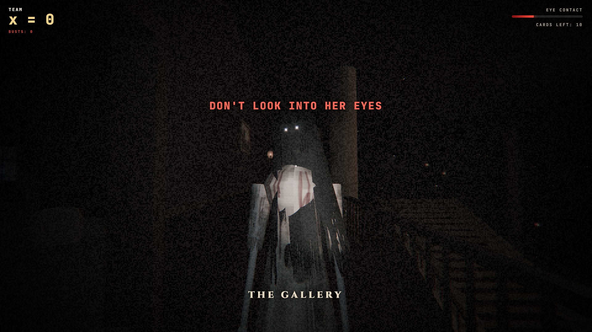
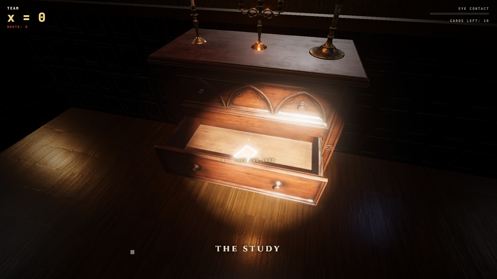
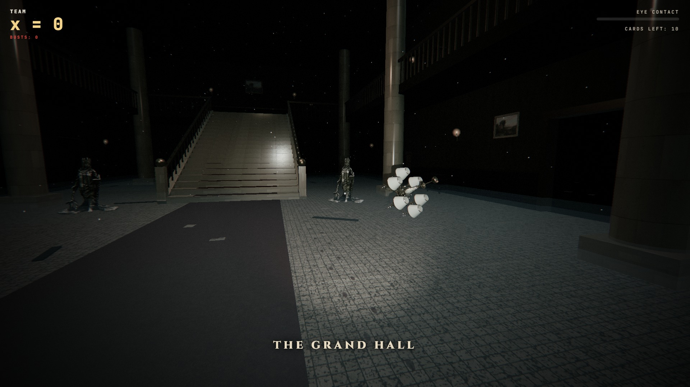
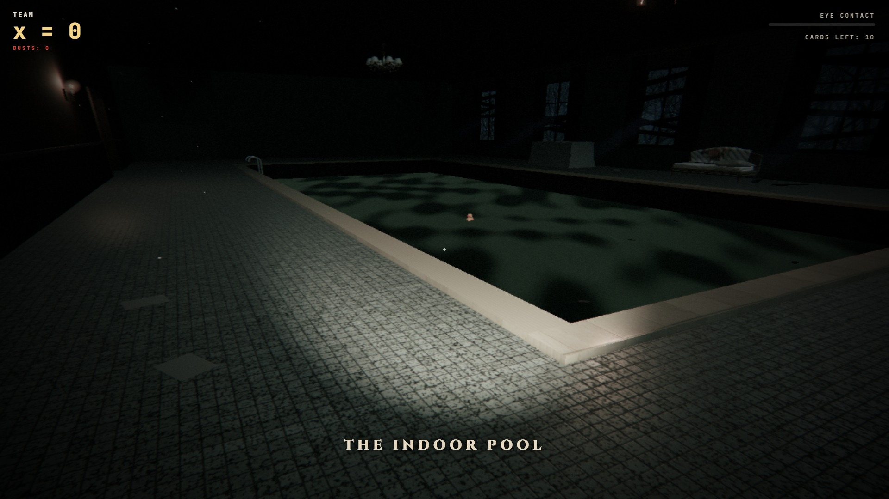
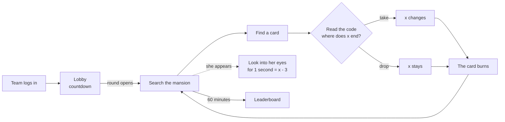

<div align="center">

<br>

# D E P T H &nbsp; F I R S T &nbsp; F E A R

### A haunted first-person card game for the DSA competition

*Search an abandoned mansion. Read the code. Don't look into her eyes.*

<br>


<br>



<br>

**[The idea](#the-idea)** · **[Play](#quick-start)** · **[Rules](#rules)** · **[The cards](#the-cards)** · **[The ghost](#the-ghost)** · **[Run the event](#running-the-competition)** · **[How it is built](#how-it-is-built)**

</div>

<br>

---

## The idea

A Data Structures quiz, turned into a horror game.

Each team walks through a dark, abandoned mansion and its haunted grounds with only a flashlight. Drawers, cupboards, chests and coffins hide **cards with a short piece of code** on them. The code starts with `x = 0` and changes `x` in several places. Read it, work out what `x` ends up as, and decide in time: **take the card** (your team's `x` changes by that amount) or **drop it**.

The team with the **highest `x`** when the 60 minutes run out wins.

But you are not alone in the house. She appears without warning. **Don't look into her eyes.**

<table>
  <tr>
    <td></td>
    <td></td>
    <td></td>
  </tr>
  <tr align="center">
    <td><sub>Cards hide in drawers</sub></td>
    <td><sub>The grand hall</sub></td>
    <td><sub>The abandoned pool</sub></td>
  </tr>
</table>

### How a round works



### What a card looks like

A made-up example (it is not one of the real cards). It is written in all three languages with exactly the same logic; players switch with the keys <kbd>1</kbd> <kbd>2</kbd> <kbd>3</kbd>.

<table>
<tr><th>C++</th><th>Java</th><th>Python</th></tr>
<tr valign="top">
<td>

```cpp
int x = 0;
stack<int> pile;
pile.push(5);
pile.push(-2);
x = x - pile.top();
pile.pop();
int bonus = pile.top() - 3;
if (bonus > 0) {
    x = x + bonus + 1;
} else {
    x = x - bonus;
}
x = x - 4;
```

</td>
<td>

```java
int x = 0;
Stack<Integer> pile = new Stack<>();
pile.push(5);
pile.push(-2);
x = x - pile.peek();
pile.pop();
int bonus = pile.peek() - 3;
if (bonus > 0) {
    x = x + bonus + 1;
} else {
    x = x - bonus;
}
x = x - 4;
```

</td>
<td>

```python
x = 0
pile = []
pile.append(5)
pile.append(-2)
x = x - pile[len(pile) - 1]
pile.pop()
bonus = pile[len(pile) - 1] - 3
if bonus > 0:
    x = x + bonus + 1
else:
    x = x - bonus
x = x - 4
```

</td>
</tr>
</table>

<details>
<summary><b>Trace it (spoiler)</b></summary>

The top of the pile is `-2`, so `x = 0 - (-2) = 2`. After the pop the top is `5`, so `bonus = 5 - 3 = 2`. `bonus` is above 0, so `x = 2 + 2 + 1 = 5`. The last line looks like a decrease: `x = 5 - 4 = 1`. The card is worth **+1**.

</details>

---

## Quick start

You need **[Node.js](https://nodejs.org)** 18 or newer. There is nothing to install: the game has no packages.

```bash
git clone https://github.com/tahaanwar31/DSA-Competition-.git
cd DSA-Competition-
```

**1. Add the secret settings.** Create a file called **`.env`** in the folder (ask the organisers for the values):

```
SUPABASE_URL=https://<project>.supabase.co
SUPABASE_SECRET_KEY=sb_secret_...
PORT=8780
```

> [!CAUTION]
> `.env` holds the database's secret key. It is in `.gitignore`. **Never commit it and never paste it in a chat.**

**2. Start the server**

```bash
npm start
```

**3. Open it** on the `PORT` in `.env` (8780 by default).

| Page | Who | What |
| --- | --- | --- |
| `http://localhost:8780` | teams | login (team name + password) |
| `/lobby` | teams | two film-poster cards: Round 01 (countdown, rules, enter button) and Round 02 (sealed). A round opens by itself at its start time |
| `/round1` | teams | the mansion, only while Round 1 is open |
| `/admin` | organisers | the control room: live rounds, teams, cards, leaderboard |

**4. Make your admin login** (once):

```bash
node scripts/add-admin.js your-name
```

> [!NOTE]
> An internet connection is needed: the database is on Supabase, and the 3D engine and the fonts load from a CDN. The server retries database reads, so a bad moment on the connection does not break a page.

### Controls

| Key | Action |
| :---: | --- |
| <kbd>W</kbd> <kbd>A</kbd> <kbd>S</kbd> <kbd>D</kbd> | Move |
| <kbd>Mouse</kbd> | Look around |
| <kbd>Shift</kbd> | Run |
| <kbd>Space</kbd> | Jump (over fences, graves and low furniture) |
| <kbd>E</kbd> | Open / close a drawer, cupboard, chest or coffin |
| <kbd>C</kbd> | Grab the card inside |
| <kbd>E</kbd> / <kbd>Q</kbd> | **Take** / **drop** the card |
| <kbd>1</kbd> <kbd>2</kbd> <kbd>3</kbd> | Show the code in C++ / Java / Python |
| <kbd>F</kbd> | Flashlight on / off |
| <kbd>N</kbd> | Map on / off |
| <kbd>M</kbd> | Sound on / off |
| <kbd>H</kbd> | Rules |
| <kbd>Esc</kbd> | Pause |

---

## Rules

1. Every team starts at **`x = 0`** and has **60 minutes**.
2. Open drawers, cupboards, chests and coffins to find cards.
3. Every card's code starts with `x = 0`. **Take** the card and your `x` changes by the value `x` ends with. **Drop** it and `x` stays the same.
4. Either way, the card **burns** and is gone. **Each card is in the mansion only once.**
5. Cards can **raise or lower** `x`, so read the code before you take it. The last line of a card often points the wrong way.
6. **Stay in the game window.** Switching to another tab or minimising it **locks your team** until an organiser lets you back in.
7. **Highest `x` when time runs out wins.** There is no upper limit.
8. **Same `x`?** The team that **reached that `x` first** is ranked higher.

### Card levels

| Level | Change to `x` | Time to decide | Where it hides |
| --- | --- | :---: | --- |
| **Easy** (46 cards) | +1 to +3 or -1 to -3 | **3 min** | the ground floor of the mansion |
| **Medium** (35 cards) | +4 to +7 or -4 to -7 | **4 min** | the first floor of the mansion |
| **Hard** (10 cards) | +8 to +12 or -8 to -12 | **5 min** | outside: the garden, the cemetery, the crypt |

If the time runs out, the card counts as a **drop**: no penalty, `x` stays the same, and the card burns.

### Where the cards are

Every team gets **the same 91 cards**, but each team's deal is different. The cards are dealt again on every load, always on their own floor, so teams cannot tell each other where a card is. About **80%** of the hiding places hold a card. Half of the cards raise `x` and half lower it, and neighbouring hiding places always get a mix of both.

A map (<kbd>N</kbd>) shows where you are and puts a dot on every hiding place that still holds a card: green for easy, yellow for medium, red for hard. The dot goes when you take the card.

---

## The cards

The deck is **91 cards: 46 easy, 35 medium, 10 hard**, written in **C++, Java and Python**.

- Every card changes `x` in **3 to 5 places**, **each in a different way**: a plain read, a read plus a number, a stored variable, a division or product of data, the size of the structure, an if / else if / else.
- The places are **spread out**, and the lines in between matter: each one changes what a later line reads.
- Hard cards always have an if and a loop over the data.
- `x` is only ever **added to or subtracted from**, and conditions look at data, never at `x`. So a card is worth the same whenever a team finds it.
- Divisions are exact, so C++, Java and Python always agree.

| Topic | What the code traces |
| --- | --- |
| **Stack** | push, pop, read the top; the top divided by the item below it |
| **Queue** | push, pop, read the front; the first divided by the second |
| **Singly linked list** | follow `next` from node to node, with negative values on the way |
| **Doubly linked list** | follow `next` and `prev` |
| **Circular linked list** | go round a small ring, with more hops than nodes |
| **BST** | read keys along paths in a tree built by hand |
| **Recursion** | small recursive functions: sums, digits, Fibonacci, powers of two |
| **BFS** | visit order on a few rooms, adding and subtracting by visit number |
| **DFS** | visit order with a stack of rooms |

<details>
<summary><b>For the card makers: how the deck is built and checked</b></summary>

<br>

The organisers keep the full deck in `db/cards-v3.js` (the builder) and `db/deck-v3.json` (the built deck, loaded through `db/cards-data.js`). They are **not** on GitHub, because they hold the answers.

The builder describes each card **once** and writes it in C++, Java and Python from that one description, so the three cannot drift apart. It runs the Python version (`db/card-harness.py`) to get the answer, and it deletes every line in turn to prove that each one matters.

| Script | What it does |
| --- | --- |
| `node scripts/check-cards.js` | Runs every card in all three languages (g++, javac / java, python) for many values of `x` and checks the answer. It also checks the style: one statement per line, 4-space indents, no `vector`, no lambdas or `?:`, short lines, and that every card starts with `x = 0`. |
| `node scripts/check-traces.js` | Stricter: the value of `x` right after **every** change must be identical in C++, Java and Python, the three versions must have the same number of lines and of `x` changes, and Python-only tricks (negative indexes) are refused. |
| `node scripts/seed-cards.js` | Loads the deck into an empty database. `--update` rewrites the cards in place (same ids) and refuses once teams have opened cards. |

Cards live in the **Supabase database**, not in the game files. The server only sends a card's code when a team opens it, and the **server** works out the new `x`.

</details>

---

## The ghost

- She appears suddenly (about every 6 to 15 seconds): right in front of you, far away down a corridor, or upside down on the ceiling.
- She has two faces, picked at random: the **pale woman** in the torn gown, and a **jinn**, a tall, lean figure of living black smoke with burning eyes and embers rising off it. The rules are the same for both.
- **Look into her eyes for 1 second** and you are **busted: `x − 3`**.
- Look away and the meter drains back down.

---

## Running the competition

The admin page is a control room with four tabs: **Live**, **Teams**, **Cards** and **Leaderboard**. The game follows every order from it, for every team at the same moment, using the server's clock (a PC's own clock does not matter).

| Step | What to do |
| --- | --- |
| **Teams** | Add every team with a password, or paste many at once (`name, password, members` per line). Teams can be edited, switched off, kicked or deleted. |
| **Times** | Each round has a **Start** box and an **End** box. Save the times and the round opens by itself. Teams wait in the lobby with a countdown. |
| **Pause** | Every team goes back to the lobby at once and progress is saved. Then choose **Resume** (same `x`, same used cards) or **Start fresh** (everyone back to `x = 0` with every card). |
| **+5 min / End now / Reopen** | Five more minutes, close the round for everyone, or run an ended round again. |
| **Open now** | Start before the set time. |
| **Reset** | One PC crashed? Reset just that team. |
| **Let back in** | A team that left the game window shows as locked. One click lets it back in. |
| **Leaderboard** | Round 1, Round 2 and Final (Round 1 + Round 2), with the time each team reached its `x`. **Big screen** is for the projector. |

Only one device can play for a team: if a team logs in on another PC, the first PC is logged out. Round 2 shows as **sealed** in the lobby for now.

---

## How it is built

| Part | What we used | Why |
| --- | --- | --- |
| 3D game | **Three.js** (WebGL) | A full 3D mansion that runs in a browser tab. Teams install nothing. |
| Models and textures | glTF models and textures from [Poly Haven](https://polyhaven.com) (CC0) | The standard 3D web format, free to use. |
| Sound | **Web Audio API** | Creaks, thunder, the iron gate and the heartbeat are made live in code. There are no audio files to download. |
| Server | **Node.js**, no packages | One file, `npm start`, nothing to break on the day. |
| Database | **Supabase** (hosted Postgres) | Every PC sees the same teams, rounds and leaderboard. |
| Game rules | Postgres functions | Taking a card, dropping it, the timers and the ghost penalty are checked on the server, so the page cannot be cheated. |
| Cards | In the database, not in the page | Teams cannot read the answers in the page source. |
| Login | scrypt password hashing, one session per team | Passwords are never stored as plain text. |

<details>
<summary><b>Project structure</b></summary>

```
├── index.html          the whole game (Three.js, WebAudio, shaders)
├── server.js           web server + game rules API (Node.js, no packages)
├── web/                login, lobby, leaderboard and admin pages
├── db/
│   ├── schema.sql      tables and the leaderboards (run in the Supabase SQL Editor)
│   └── functions.sql   take / drop / bust / timers, all checked on the server
├── scripts/            add-admin, seed-cards, check-cards, check-traces
├── .env                secret settings (you make it; never on GitHub)
├── assets/
│   ├── models/         3D furniture, statues, trees, gates (glTF)
│   ├── tex/            wall, floor and stone textures
│   └── ui/             menu backgrounds
└── docs/               screenshots
```

</details>

### Features

- A full two-floor mansion: grand hall, library, study, kitchen, dining room, nursery, master bedroom, gallery and an abandoned indoor pool
- Haunted grounds: courtyard, dead forest, cemetery and crypt, with rain, fog and lightning
- A map, a mute key, and a card timer that keeps running on the real clock
- Team login (*"Come in. Everyone else did."*), a lobby with two film-poster round cards, an admin control room, three live leaderboards
- Cards that burn away after you take or drop them
- Working drawers, cupboards, chests, coffins, doors and gates (the iron gate to the forest clangs like real steel)
- A ghost with an eye-contact meter and jumpscares, and a jinn made of smoke
- Lit windows where shadows move when you are outside
- Runs on normal laptops: power saving when paused, one active tab at a time, automatic resolution

---

## Contributing

Co-heads: **do not push to `main`.** Make a branch, push it, and open a Pull Request. It gets merged after review. The step-by-step guide is in **[CONTRIBUTING.md](CONTRIBUTING.md)**.

---

## Credits

- **3D models and textures:** [Poly Haven](https://polyhaven.com) (CC0)
- **Engine:** [Three.js](https://threejs.org) r170
- **Fonts:** Cinzel, Cormorant Garamond, Anton, Rock Salt, JetBrains Mono, IBM Plex Sans (Google Fonts)

<div align="center">

<br>

**PROCOM 27 · Software Engineering Competitions category**
DSA Module · Depth First Fear

</div>
